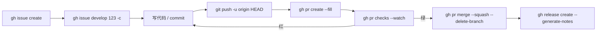

# GitHub CLI (`gh`) 实战手册

> **适用**：gh 2.x（`gh --version` 自检）
> **依据**：`cli.github.com/manual` 逐条核对，非二手文章
> **最后验证**：2026-10-30
> **原则**：本文所有 `bash` 代码块均可直接复制执行，且已通过 `bash -n` 语法检查。注释一律写在命令行**上方**——写在 `\` 续行后面会让整段命令失效。

---

## 目录

- [0. 一分钟上手](#0-一分钟上手)
- [1. 认证：最容易踩坑的一层](#1-认证最容易踩坑的一层)
- [2. 心智模型：gh 的三层能力](#2-心智模型gh-的三层能力)
- [3. 每天都会用的十条](#3-每天都会用的十条)
- [4. 工作流 A：给别人的项目提 PR](#4-工作流-a给别人的项目提-pr)
- [5. 工作流 B：issue → 分支 → PR → 合并](#5-工作流-bissue--分支--pr--合并)
- [6. 工作流 C：审别人的 PR](#6-工作流-c审别人的-pr)
- [7. 工作流 D：CI 与 Actions](#7-工作流-dci-与-actions)
- [8. 工作流 E：发布版本](#8-工作流-e发布版本)
- [9. 工作流 F：写进脚本](#9-工作流-f写进脚本)
- [10. `gh api`：没有子命令时的兜底](#10-gh-api没有子命令时的兜底)
- [11. 别名与扩展](#11-别名与扩展)
- [12. 排错对照表](#12-排错对照表)
- [13. 反模式：这些事别用 gh 做](#13-反模式这些事别用-gh-做)
- [14. 命令速查](#14-命令速查)
- [15. 参考与已知限制](#15-参考与已知限制)

---

## 0. 一分钟上手

```bash
# 安装（三选一，按发行版）
brew install gh                      # macOS / Linuxbrew
sudo apt install gh                  # Debian / Ubuntu（版本较旧，见 1.5）
sudo dnf install gh                  # Fedora

# 登录（交互：浏览器授权或粘贴 token）
gh auth login

# 让 git 也复用 gh 的凭据，否则 https 推送仍会问密码
gh auth setup-git

# 自检
gh auth status
gh --version
```

**gh 到底替你省了什么**——判断要不要用它，看这张表就够了：

| 网页操作                                  | gh 命令                                             |
| ----------------------------------------- | --------------------------------------------------- |
| 建仓库、加描述、连本地目录                | `gh repo create --source=. --push`                  |
| Fork 别人的项目并配好 remote              | `gh repo fork owner/repo --clone`                   |
| 建建 issue                                | `gh issue create`                                   |
| 从 issue 拉分支（含关联，网页得点两三次） | `gh issue develop 123 --checkout`                   |
| 看 CI 红了哪一步                          | `gh pr checks --watch` → `gh run view --log-failed` |
| 检出同事的 PR 到本地跑                    | `gh pr checkout 456`                                |
| 发布 + 生成 release notes                 | `gh release create v1.0.0 --generate-notes`         |

反过来，需要**逐行看 diff、解复杂冲突、读完整 review 讨论串**时，回网页或编辑器，别硬扛。

---

## 1. 认证：最容易踩坑的一层

### 1.1 登录、状态、多账号

```bash
gh auth login                                  # 交互式，推荐
gh auth login --git-protocol ssh               # 走 SSH
gh auth login --hostname ghe.example.com       # GitHub Enterprise Server

gh auth status                                 # 当前账号、token 权限、协议

gh auth switch                                 # 多账号间切换
gh auth token                                  # 打印当前 token（勿贴进日志）
```

非交互（CI 或沙箱）认证：

```bash
# token 从标准输入喂入，避免出现在 shell history
gh auth login --with-token < ~/.secrets/gh_token.txt
```

### 1.2 `setup-git`：被绝大多数教程漏掉的一步

```bash
gh auth setup-git
```

它把 gh 注册成 git 的 credential helper。没做这一步，`gh` 一切正常，但 `git push` 仍会卡在 `Username for 'https://github.com':`——这是新手最常见的“gh 装了但没用”的原因。

查看 / 修改 git 协议偏好：

```bash
gh config list
gh config set git_protocol ssh
gh config set editor nvim
```

### 1.3 脚本与 CI：用 `GH_TOKEN`，别用登录态

```bash
# 脚本里显式注入；GH_TOKEN 优先级高于 gh auth login 存的凭据
export GH_TOKEN="$(cat ~/.secrets/gh_token.txt)"

gh pr list --limit 5
```

> ⚠️ **坑**：`GH_TOKEN` 一旦 export 且指向过期/无效 token，所有 gh 命令都会报 `HTTP 401: Bad credentials`，哪怕 `gh auth status` 显示一切正常。排查第一件事就是 `env | grep -i -E 'GH_TOKEN|GITHUB_TOKEN'`。

### 1.4 权限不足的两种典型症状

| 症状                                                        | 真实原因                                         |
| ----------------------------------------------------------- | ------------------------------------------------ |
| `HTTP 404: Not Found`（明明仓库存在）                       | 细粒度 PAT 没勾这个仓库 → GitHub 用 404 掩盖 403 |
| `GraphQL: Resource not accessible by personal access token` | 缺 scope（`repo`、`read:org`、`workflow` 等）    |

补权限：

```bash
gh auth refresh -s repo -s read:org -s workflow
gh auth status                          # 确认 Scopes 一行已包含所需项
```

### 1.5 发行版仓库版本偏旧

`apt`/`dnf` 源里的 gh 常常落后一两个大版本，新子命令会“不存在”。判断方法：

```bash
gh --version
gh help                     # 列出的顶层命令就是你这个版本真实拥有的
```

本文用到的较新能力（`gh issue develop --worktree`、`gh repo gitignore`、`gh pr checks --required` 等）在旧版本上会报 `unknown flag`，属正常，升级即可。

---

## 2. 心智模型：gh 的三层能力

理解这三层，比背 50 条命令有用。

**L1 直连命令**：`gh pr list`、`gh issue view 13`——覆盖 90% 日常，输出给人看。

**L2 结构化输出**：`--json` + `--jq` / `--template`。**这是 gh 从“命令集合”变成“可编排工具”的分水岭**，也是脚本唯一可靠的基础。

```bash
gh pr list --json number,title,author --jq '.[] | "\(.number) \(.author.login) \(.title)"'

gh pr list --json number,headRefName --template '{{range .}}{{.number}} {{.headRefName}}{{"\n"}}{{end}}'
```

**L3 API 兜底**：`gh api`。任何 GitHub REST/GraphQL 端点，带自动认证、分页、jq。

```bash
gh api repos/{owner}/{repo}/branches/main/protection --jq '.required_pull_request_reviews'
```

> 💡 `{owner}`、`{repo}` 会从当前仓库自动替换；`-R owner/repo` 可指定别的仓库。

**格式化语法**：`gh help formatting` 给出全部占位符与模板函数。

---

## 3. 每天都会用的十条

```bash
# 1. 我现在要处理什么（分配给我的 issue、待我审的 PR、我 PR 的 CI 状态）
gh status

# 2. 我这个分支的 PR 现在什么情况
gh pr status

# 3. 看 CI，等它出结果（绿了自动返回，红了自动返回）
gh pr checks --watch

# 4. CI 红了，直接打印失败步骤的日志
gh run view --log-failed

# 5. 检出别人的 PR 到本地跑
gh pr checkout 456

# 6. 开 PR，标题正文自动用 commit message 填
gh pr create --fill

# 7. 开草稿 PR（还没准备好评审）
gh pr create --draft --fill

# 8. 分配给我、还没关的 issue
gh issue list --assignee @me --state open

# 9. 打开当前仓库页面（省一次浏览器操作）
gh browse

# 10. 任何命令忘了参数
gh pr create --help
```

`gh pr checks` 的退出码对脚本很友好：**0 全过 / 1 有失败 / 8 还在跑**。所以“等 CI 再合并”可以写成：

```bash
gh pr checks --watch && gh pr merge --squash --delete-branch
```

---

## 4. 工作流 A：给别人的项目提 PR

```bash
# Fork 并克隆，自动把 origin 指向你的 fork、upstream 指向原仓库
gh repo fork cli/cli --clone

cd cli

# 只建 fork 不克隆（只是想拥有一个 fork 时）
cd ~/projects
gh repo fork cli/cli --clone=false

# 基于上游默认分支开工作分支
git switch -c fix/help-text-typo

# ...改代码...
git add -A
git commit -m "fix: 修正 help 文本拼写"

# 推送到你的 fork
git push -u origin HEAD

# 向上游开 PR
gh pr create \
  --title "fix: 修正 help 文本拼写" \
  --body "Fixes #123" \
  --repo cli/cli
```

要点：

- `gh repo fork` 默认会**加好 `upstream` remote**，不用手写 `git remote add`。
- `--clone=false` 才是“只 fork 不克隆”。注意它是 `--flag=false` 形式，没有 `--no-clone`。
- 正文里写 `Fixes #123` 才会**关联并自动关闭**对应 issue；只写 `#123` 只是引用，不会关。
- 上游有更新时同步 fork：

```bash
gh repo sync                       # 同步当前仓库（fork）
gh repo sync owner/fork --source owner/upstream
```

---

## 5. 工作流 B：issue → 分支 → PR → 合并

这是 gh 相对网页收益最大的一条链。



### 5.1 建 issue

```bash
gh issue create \
  --title "Safari 下无法登录" \
  --body "复现步骤：1. 打开 /login 2. 输入正确密码 3. 页面空白" \
  --label bug \
  --assignee @me
```

### 5.2 从 issue 直接拉分支（`gh issue develop`）

```bash
# 在 GitHub 端创建与 issue 关联的分支，并在本地检出
gh issue develop 123 --checkout

# 指定 base 分支（默认是仓库默认分支）
gh issue develop 123 --base develop --checkout

# 自定义分支名（默认是「123-issue-标题」，想守命名规范就用这个）
gh issue develop 123 --name fix/safari-login --checkout

# 直接开一个 worktree，主工作区不被打断
gh issue develop 123 --checkout --worktree ../wt-safari-login

# 查这个 issue 已经关联了哪些分支
gh issue develop --list 123
```

分支由 GitHub 端创建并建立关联，本地 `--checkout` 只是跟进。**关联之后，PR 会自动回填到 issue 的时间线**。

### 5.3 提交并开 PR

```bash
git add -A
git commit -m "fix: Safari 下登录白屏" -m "原因是 localStorage 在隐私模式下抛异常，改为 try/catch 降级到内存存储。"

git push -u origin HEAD

gh pr create \
  --title "fix: Safari 下登录白屏" \
  --body "Fixes #123" \
  --assignee @me \
  --label bug \
  --reviewer teammate1,teammate2
```

常用变体：

```bash
gh pr create --fill                    # 标题正文取自 commit
gh pr create --draft                   # 草稿，先要反馈
gh pr create --web                     # 浏览器里写（描述需要贴图时）
gh pr create --base develop            # 目标分支不是 main
gh pr create --fill --dry-run          # 只打印将要用的标题正文
```

> ⚠️ **坑**：分支没推时 `gh pr create` 会报 `Head sha can't be blank`（或提示先 push）。先 `git push -u origin HEAD`。

### 5.4 迭代：draft PR 的正确用法

```bash
gh pr ready                            # 草稿 → 可评审
gh pr edit --add-label ready-for-review
gh pr view --comments                  # 读评审意见
```

长期任务用 draft PR 的价值：早期就能拿到方向性反馈，避免一次性丢出 2000 行 diff。

### 5.5 合并与清理

```bash
gh pr checks --watch                   # 先确认 CI
gh pr merge --squash --delete-branch   # 压缩合并并删掉本地+远程分支

# 等检查通过后自动合并（需仓库开启 auto-merge）
gh repo edit --enable-auto-merge
gh pr merge --auto --squash --delete-branch

# 分支要求走 merge queue 时：不加 --squash，检查过就直接入队
gh pr merge --delete-branch

git switch main
git pull
```

> ⚠️ 不要给功能分支设 `git branch --set-upstream-to=origin/main`。那会让该分支的 upstream 指向 main，之后误用 `git push` 的后果很难收拾。`git push -u origin HEAD` 已经解决一切。

### 5.6 分支命名：选一套，别混

`gh issue develop` 默认产出 `123-safari-登录` 这类名字。有两种做法，二选一：

- **跟随默认**：简单，issue 与分支一眼对得上，适合个人项目。
- **团队规范**：统一 `<type>/<slug>`，用 `--name fix/safari-login` 覆盖默认名。

最差的是同一份流程里同时出现 `123-fix-login`、`bugfix/safari-login`、`bugfix-branch` 三种写法——三个月后没人知道哪个是哪个。

---

## 6. 工作流 C：审别人的 PR

```bash
# 列出待我评审的 PR
gh pr list --search "review-requested:@me" --state open

# 看概况（标题、描述、CI、评审状态）
gh pr view 456

# 读讨论串
gh pr view 456 --comments

# 检出到本地，跑测试、看真实行为
gh pr checkout 456

# 看改动（大 PR 建议本地 diff 或编辑器，见第 13 节）
gh pr diff 456

# 批准
gh pr review 456 --approve --body "LGTM，两点小建议见行内评论"

# 只评论 / 请求修改
gh pr review 456 --comment --body "第 3 个文件的分支可以合并成一个早返回"
gh pr review 456 --request-changes --body "缺少对 429 的处理"
```

> 不能批准自己开的 PR——`--approve` 对自己的 PR 会被 GitHub 拒绝，这是平台规则不是 gh 的 bug。

CI 细节定位：

```bash
# 换成实际的 run id（gh pr checks 里链接末尾那串数字）
RUN_ID=1234567890

gh pr checks 456 --required           # 只看必需检查
gh pr checks 456 --json name,bucket   # 结构化，bucket ∈ pass/fail/pending/skipping/cancel
gh run view "$RUN_ID" --log-failed    # 失败步骤日志
gh run view "$RUN_ID" --web           # 实在要看完整时间线时
```

---

## 7. 工作流 D：CI 与 Actions

```bash
# 最近的运行
gh run list --limit 10
gh run list --workflow ci.yml --branch main

# 手动触发带 inputs 的 workflow
gh workflow run deploy.yml -f environment=staging

# 后续命令统一引用这个 id（换成 gh run list 里看到的值）
RUN_ID=1234567890

# 重跑只失败的 job（省时）
gh run rerun "$RUN_ID" --failed

# 取消
gh run cancel "$RUN_ID"

# 下载构建产物
gh run download "$RUN_ID" -n artifact-name -D ./dist

# 缓存
gh cache list
gh cache delete 12345
```

**等待运行结束的正确脚本写法**——`gh run watch` 不带参数时需要交互选择，在脚本里会卡住：

```bash
# 取最近一次运行的 id，再 watch 它
RUN_ID=$(gh run list --workflow ci.yml --limit 1 --json databaseId --jq '.[0].databaseId')
gh run watch "$RUN_ID" --exit-status
```

`--exit-status` 让失败时返回非零，可以直接接 `||` 分支。

---

## 8. 工作流 E：发布版本

版本号只维护**一处**，其余全部引用它——否则 tag 与 `package.json` 迟早对不上。

```bash
# 1) 从干净的主干开始
git switch main
git pull

# 2) 确定版本，作为唯一事实来源
VERSION=1.4.0

# 3) 同步到项目元数据（Node 项目；其他语言改对应文件）
npm version "$VERSION" --no-git-tag-version

# 4) 更新 CHANGELOG（需要变量展开，所以定界符不能加引号）
DATE=$(date +%F)
cat > CHANGELOG.md <<EOF
# 更新日志

## [$VERSION] - $DATE

### 新增
- 登录页支持 Passkey

### 修复
- Safari 隐私模式下登录白屏
EOF

# 5) 提交
git add -A
git commit -m "chore(release): v$VERSION"

# 6) 打 tag 并推送（先推代码再推 tag，避免 CI 拿到半成品）
git push
git tag -a "v$VERSION" -m "v$VERSION"
git push origin "v$VERSION"
```

发布 release：

```bash
# 用 GitHub 自动生成的 release notes（推荐，零维护）
gh release create "v$VERSION" --title "v$VERSION" --generate-notes --verify-tag

# 或者用自己写的 CHANGELOG
gh release create "v$VERSION" --title "v$VERSION" --notes-file CHANGELOG.md --verify-tag

# 预发布
gh release create "v$VERSION-beta.1" --prerelease --title "v$VERSION Beta 1"

# 追加二进制产物
gh release upload "v$VERSION" ./dist/app.zip ./dist/app.tar.gz --clobber

# 校验 / 修改 / 删除
gh release view "v$VERSION"
gh release edit "v$VERSION" --draft=false
gh release delete "v$VERSION" --cleanup-tag
```

> ⚠️ **坑**：`--generate-notes` 依赖 PR 标题规范化。仓库里 PR 标题乱写，生成的 notes 就是垃圾——这反而是推行 “PR 标题符合 conventional commits” 的最好理由。

**用 gh 本身做发布流水线**（不需要第三方 action，runner 上预装 gh）：

```yaml
name: Release
on:
  push:
    tags: ["v*"]

permissions:
  contents: write # 缺这行 gh release create 会 403

jobs:
  release:
    runs-on: ubuntu-latest
    env:
      GH_TOKEN: ${{ github.token }}
    steps:
      - uses: actions/checkout@v4
      - uses: actions/setup-node@v4
        with:
          node-version: 22
      - run: npm ci
      - run: npm test
      - run: gh release create "$GITHUB_REF_NAME" --generate-notes --verify-tag
```

语义化版本判断标准：**MAJOR** 不兼容变更 / **MINOR** 向下兼容的新功能 / **PATCH** 向下兼容的修复。

---

## 9. 工作流 F：写进脚本

### 9.1 三条铁律

1. **不解析人类可读输出**，一律 `--json` + `--jq`。
2. **不假设“最新”**，显式取字段排序后再用。
3. **token 从环境来**，`GH_TOKEN` 注入，绝不硬编码。

### 9.2 幂等示例：确保 issue 存在，否则创建

```bash
TITLE="每周依赖升级"

EXISTING=$(gh issue list \
  --state open \
  --search "$TITLE in:title" \
  --json number \
  --jq '.[0].number')

if [ -n "$EXISTING" ]; then
  echo "已存在：#$EXISTING"
else
  gh issue create --title "$TITLE" --body "由脚本自动创建"
fi
```

### 9.3 批量操作：先 dry-run，再执行

```bash
# 先看要动谁
gh pr list --state open --json number,title --jq '.[] | "\(.number)\t\(.title)"'

# 确认无误后逐个打标签
gh pr list --state open --json number --jq '.[].number' | while read -r n; do
  echo "labeling #$n"
  gh pr edit "$n" --add-label "status/needs-review"
done
```

### 9.4 跨仓库

```bash
gh pr list --repo owner/repo --state open
gh issue view 42 --repo owner/repo
gh api repos/owner/repo/releases/latest --jq '.tag_name'
```

> 💡 在 fork 场景下 gh 可能猜错目标仓库，用 `gh repo set-default owner/repo` 钉死。

---

## 10. `gh api`：没有子命令时的兜底

```bash
# GET，自动分页并合并结果
gh api --paginate repos/owner/repo/issues --jq '.[].title'

# 取单个字段
gh api repos/owner/repo --jq '.stargazers_count'

# POST：-f 传字符串，-F 传带类型的值
gh api repos/owner/repo/issues \
  -f title="脚本创建的 issue" \
  -f body="正文" \
  -F assignee=@me

# 加协作者（gh 本身没有 add-collaborator 子命令）
gh api --method PUT repos/owner/repo/collaborators/USERNAME \
  -F permission=push

# 读分支保护现状
gh api repos/owner/repo/branches/main/protection

# 列出规则集（GitHub 现在主推 Rulesets，网页端 Settings → Rules）
gh api repos/owner/repo/rulesets --jq '.[] | "\(.id) \(.name) \(.target)"'
```

GraphQL 也可以，适合一次拿多种数据：

```bash
gh api graphql -f query='
  query($owner: String!, $repo: String!) {
    repository(owner: $owner, name: $repo) {
      pullRequests(states: OPEN, last: 10) {
        nodes { number title reviewDecision }
      }
    }
  }' -f owner=cli -f repo=cli
```

> 写操作（尤其 rulesets / 分支保护）请求体字段多、且各版本会演进，建议：**读用 `gh api`，写优先 UI**，或把完整 JSON 存成文件用 `--input body.json` 提交，便于 review 与回滚。

---

## 11. 别名与扩展

```bash
# 普通别名（映射到 gh 子命令）
gh alias set pv 'pr view --comments'
gh alias set co 'pr checkout'          # 补上 hub 时代的手感

# shell 别名：可以接管道和自己拼参数
gh alias set --shell fco 'gh pr list --json number,headRefName --jq ".[0].number" | xargs gh pr checkout'

gh alias list
gh alias delete co
```

扩展：

```bash
gh extension list
gh extension install owner/gh-something
gh extension upgrade --all
```

---

## 12. 排错对照表

| 报错 / 症状                                                                                | 原因                      | 处理                                                             |
| ------------------------------------------------------------------------------------------ | ------------------------- | ---------------------------------------------------------------- |
| `gh: command not found`                                                                    | 未安装或不在 PATH         | `gh --version`；确认安装路径                                     |
| `HTTP 401: Bad credentials`                                                                | `GH_TOKEN` 指向失效 token | `env \| grep -i gh_token`，unset 或换新                          |
| `HTTP 404: Not Found`（仓库明明在）                                                        | 细粒度 PAT 无该仓库权限   | `gh auth refresh -s repo`，或改用 classic token                  |
| `GraphQL: Resource not accessible by personal access token`                                | 缺 scope                  | 同上；`gh auth status` 看 Scopes                                 |
| `must be run from inside a git repository`                                                 | 当前目录不是仓库          | `cd` 进去，或加 `-R owner/repo`                                  |
| `the --source option is not supported with --clone, --template, --license, or --gitignore` | 参数互斥（gh 明确禁止）   | 先 `gh repo create --source=. --push`，再单独补 README/license   |
| `pull request create failed: GraphQL: Head sha can't be blank`                             | 分支未推送                | `git push -u origin HEAD`                                        |
| `error: remote origin already exists`                                                      | 已有 origin               | `gh repo create --source=. --remote=upstream`                    |
| `failed to determine base repo`                                                            | fork / 多 remote 场景歧义 | `gh repo set-default owner/repo`                                 |
| `fatal: could not read Username for 'https://github.com'`                                  | 未跑 `setup-git`          | `gh auth setup-git`                                              |
| `unknown flag: --xxx`                                                                      | 版本太旧                  | `gh --version` 后升级                                            |
| `gh pr checks` 返回 8 但“看起来没报错”                                                     | 8 = 检查未完成，不是错误  | 脚本里区分 `0/1/8`                                               |
| 企业版命令全 404                                                                           | 未指定 hostname           | `gh auth login --hostname ghe.example.com`；`-R host/owner/repo` |

---

## 13. 反模式：这些事别用 gh 做

- **解复杂三方冲突**：开编辑器 / `git mergetool`，gh 只负责 `gh pr checkout` 把现场准备好。
- **逐行审大 diff**：`gh pr diff` 走 API，超大 PR 体验差。检出后本地 diff，或回网页。
- **在脚本里 grep 人类可读输出**：格式随时变，改 `--json`。
- **用 `gh auth login` 上 CI**：交互式且会落盘长期凭据，用 `GH_TOKEN`。
- **手搓 `gh api` 做已有子命令的事**：`gh pr merge --auto` 比调 GraphQL 稳。
- **把 token 写进 `.zshrc` 或仓库**：secret 注入，用完即焚。
- **`git commit -am` 一把梭**：漏掉新文件，是“PR 里少个文件”的经典成因。
- **在 `\` 续行后写注释**：bash 只把 `\` 后紧跟的换行当续行，`--flag \   # 注释` 会让命令在此断开，后续参数被当作独立命令执行。

---

## 14. 命令速查

| 类别    | 命令                                                                              | 说明                       |
| ------- | --------------------------------------------------------------------------------- | -------------------------- |
| 认证    | `gh auth login` / `status` / `switch` / `refresh -s repo` / `setup-git` / `token` | 配置与排错                 |
| 仓库    | `gh repo create --source=. --push`                                                | 本地目录 → 远程仓库        |
|         | `gh repo fork o/r --clone` / `--clone=false`                                      | Fork 并配好 remote         |
|         | `gh repo clone o/r` / `view` / `sync` / `set-default`                             | 日常                       |
|         | `gh repo gitignore` / `gh repo license`                                           | 查模板清单（只查，不写入） |
| issue   | `gh issue create` / `list --assignee @me` / `view N --comments`                   |                            |
|         | `gh issue develop N -c` / `--base` / `--name` / `--worktree` / `--list`           | issue ↔ 分支               |
|         | `gh issue close N` / `reopen N`                                                   |                            |
| PR      | `gh pr create --fill` / `--draft` / `--web` / `--base`                            |                            |
|         | `gh pr list` / `status` / `view N --comments` / `diff N` / `checkout N`           |                            |
|         | `gh pr checks --watch` / `--required` / `--json name,bucket`                      | CI 状态，退出码 0/1/8      |
|         | `gh pr review N --approve` / `--comment` / `--request-changes`                    |                            |
|         | `gh pr ready` / `edit` / `close`                                                  |                            |
|         | `gh pr merge --squash --delete-branch` / `--auto`                                 |                            |
| Actions | `gh run list` / `view --log-failed` / `watch <id> --exit-status`                  |                            |
|         | `gh run rerun <id> --failed` / `cancel` / `download`                              |                            |
|         | `gh workflow list` / `run wf.yml -f k=v`                                          |                            |
|         | `gh cache list` / `delete <id>`                                                   |                            |
| 发布    | `gh release create vX --generate-notes` / `--notes-file` / `--prerelease`         |                            |
|         | `gh release upload` / `view` / `edit` / `delete --cleanup-tag`                    |                            |
| 检索    | `gh search prs` / `issues` / `repos` / `code` / `commits`                         |                            |
| api     | `gh api path --jq` / `--paginate` / `-f` / `-F` / `--input`                       | REST                       |
|         | `gh api graphql -f query='...'`                                                   | GraphQL                    |
| 配置    | `gh config list` / `set git_protocol ssh` / `set editor nvim`                     |                            |
| 扩展    | `gh alias set` / `list` / `delete`；`gh extension install` / `upgrade --all`      |                            |

---

## 15. 参考与已知限制

**官方（唯一可信来源，本文全部据此核对）**

- 命令索引：<https://cli.github.com/manual/gh>
- 格式化语法：`gh help formatting`
- REST 端点：<https://docs.github.com/rest>
- Actions 权限模型：<https://docs.github.com/actions/security-for-github-actions/security-guides/automatic-token-authentication>

**已知限制**

- 版本演进快：`unknown flag` 一律先查 `gh --version`，别怀疑语法。
- GitHub 正在把“分支保护规则”迁到 **Rulesets**，网页端文案与老教程不一致属正常；CLI 侧目前没有一等公民命令，读用 `gh api`，写建议 UI。
- `gh pr diff` 走 API，超大 diff 可能截断；需要完整 diff 请 `gh pr checkout` 后本地比。
- `gh run watch` 无参数是交互式的，脚本里必须显式给 run id。
- 本文不覆盖：GitHub Copilot CLI（独立产品）、`gh extension` 生态推荐清单、企业 SSO 授权细节。
